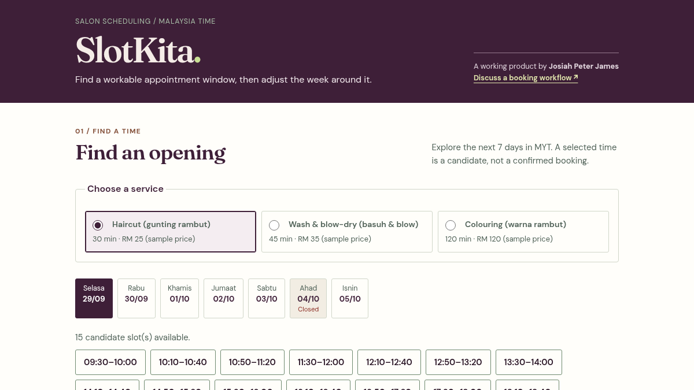

# SlotKita

A browser-only appointment planner for Malaysian salons, built with vanilla JavaScript, HTML and CSS by Josiah Peter James.

**[Live demo](https://slotkita-20260928.pages.dev/)**



## Run locally

Requirements: Node.js (tested with v26.8.2) for tests, Python 3 for the local static server, and a modern browser. No npm dependencies or build step.

From this repository's root:

```sh
node test.js
python3 -m http.server 8000 --bind 127.0.0.1
```

Open http://127.0.0.1:8000/ . Stop the server with Ctrl+C.

## What it demonstrates

- Service durations, weekly opening hours, setup/cleanup buffers and unavailable blocks.
- Overlap validation and automatic invalidation of a selected slot after schedule edits.
- Malaysia Time (UTC+8) date handling, including month/year boundaries.
- Downloadable tentative `.ics` calendar holds with UTC timestamps, plus copyable summaries.
- Responsive layouts, labelled inputs and visible keyboard focus.

## Structure and tests

- `slot-engine.js`: DOM-free scheduling and calendar-export logic, shared by Node and the browser.
- `app.js`: in-memory state, DOM rendering and user interactions.
- `index.html`, `styles.css`: page structure and responsive presentation.
- `test.js`: dependency-free Node assertion suite covering dates, overlaps, buffers, selection invalidation and calendar exports.
- `docs/slotkita.png`: screenshot of the live demo; the local version replaces its contact link with schedule navigation.

Run `node test.js` for the engine suite. This is not an end-to-end browser suite. The original machine-specific browser harness is intentionally not included.

## Demo limitations

This is a scheduling prototype, **not a booking service**. It has no backend, authentication, database, payment integration or calendar synchronization. State exists only in the current tab's memory and resets on reload. Prices, services and opening hours are sample data. Selecting or exporting a slot does not reserve anything or contact a salon.

The planner uses same-day opening intervals (no overnight hours), a seven-day view, and does not filter out elapsed times today. Production use would need server-side validation, persistent availability and concurrency controls. Clipboard access depends on browser permissions; a manual-copy fallback is provided.

Scheduling inputs are not transmitted by the application. CSS requests fonts from Google Fonts; fallback fonts are available. External portfolio/demo links navigate away when clicked.

This curated source snapshot excludes deployment configuration, account identifiers, private logs and original Git history.
